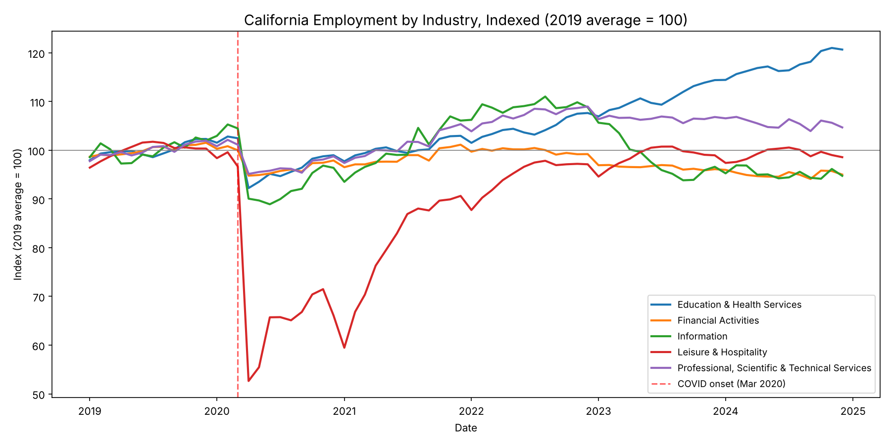

# California Employment Trends by Industry (2019–2024)

An analysis of how five California industries moved through the COVID-19 shock and the 2022–2024 period, using monthly BLS employment data.

## Core Question
Which California industries were hit hardest by COVID-19, which recovered, and which have lost ground since 2022?

## Tools & Skills
- **Python** (pandas, matplotlib, requests)
- **BLS API**: Current Employment Statistics, 5 industries × 72 months (2019–2024)
- **SQLite**: cleaned data stored in a relational database
- **SQL**: window functions (LAG, RANK), CTEs, CASE WHEN, aggregations

## Key Findings
1. **Leisure & Hospitality was hit hardest.** Employment fell 47.1% from February to April 2020 and 27.2% on an annual-average basis, more than 5 times the next-hardest-hit industry. By 2024 it was still 0.9% below 2019.
2. **Information employment fell 12.5% from its 2022 peak.** It grew to 617.6K jobs in 2022, then fell to 540.1K in 2024, 4.8% below 2019. The timing is consistent with the 2023–2024 tech layoffs.
3. **Education & Health Services grew the most.** After a 2.5% drop in 2020, it grew every year, with growth accelerating to +195K jobs in 2024. It ended 17.6% above 2019.
4. **Professional, Scientific & Technical Services held its gains.** It peaked in 2022 and declined only slightly after (−1.5%), ending 5.6% above 2019.
5. **Financial Activities steadily lost ground.** It never recovered its 2019 level and ended 2024 4.9% below it.

## Visualizations

### Employment by Industry, Indexed to 2019

### COVID Impact by Industry (2019 vs. 2020)

## Limitations
- **Descriptive only.** No causal analysis was performed; references to layoffs describe timing, not cause.
- **Not seasonally adjusted** (BLS `SMU` series). Annual averages remove most seasonality; month-to-month changes include seasonal swings.
- **Annual averages smooth the spring 2020 crash.** The monthly drop was much steeper (see Finding 1).
- **Five industries, not the full economy.** Construction, manufacturing, trade, government and others are excluded.
- **Education & Health Services combines private education with health care**; the series does not isolate health care.
- **Statewide data.** Bay Area trends, especially in tech, may differ.

## Data Source
[U.S. Bureau of Labor Statistics (BLS) API](https://www.bls.gov/developers/): Current Employment Statistics, State and Area, California (all employees, thousands)

| Series ID | Industry |
|---|---|
| SMU06000007000000001 | Leisure & Hospitality |
| SMU06000005500000001 | Financial Activities |
| SMU06000006500000001 | Education & Health Services |
| SMU06000005000000001 | Information |
| SMU06000006054000001 | Professional, Scientific & Technical Services |

## How to Run
1. Clone this repo
2. Install dependencies: `pip install pandas matplotlib requests`
3. Optional, to pull fresh data: get a free BLS API key at [bls.gov/developers](https://www.bls.gov/developers/), then in Terminal run `export BLS_API_KEY="your_key"`
4. Run all cells in `ca-employment-trends.ipynb`. Without a key, the notebook uses the saved data in `data/raw_bls_data.csv`.
