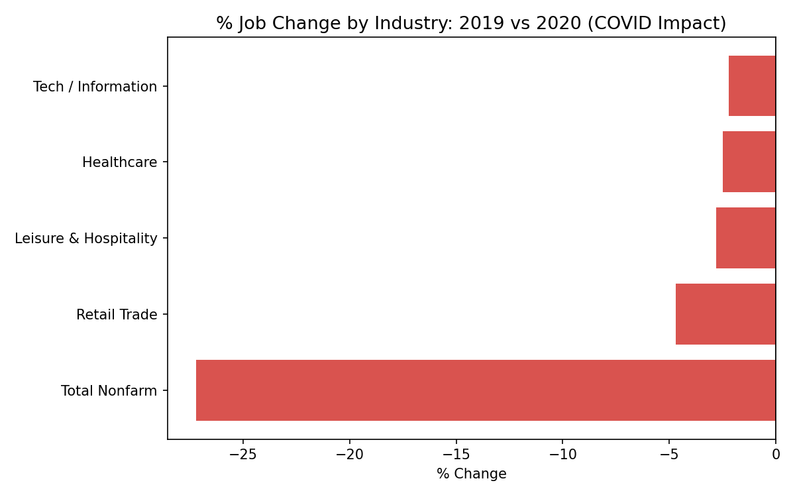

# California Employment Trends by Industry (2019–2024)

A data analysis project examining how California's labor market shifted 
across key industries before, during, and after the COVID-19 pandemic.

## Tools & Skills
- **Python** (pandas, matplotlib, seaborn, requests)
- **BLS API** — automated data pull for 5 industries across 72 months
- **SQLite** — cleaned data stored in a relational database
- **SQL** — window functions (LAG), CASE WHEN, GROUP BY, aggregations

## Key Findings
1. **Total Nonfarm employment dropped 27.2%** in 2020 — the steepest 
   COVID impact tracked, reflecting economy-wide disruption.
2. **Healthcare was the most resilient sector**, dropping only 2.5% in 
   2020 and growing continuously through 2024, adding ~195K jobs YoY by 2024.
3. **Tech / Information showed post-layoff softening** — after peaking in 
   2022, employment declined in both 2023 (-8.9K) and 2024 (-13.1K), 
   consistent with Bay Area tech layoff trends.
4. **Leisure & Hospitality never fully recovered** — still declining in 
   2023 and 2024, suggesting structural shifts post-pandemic.

## Visualizations

### Employment Trends Over Time

### COVID Impact by Industry (2019 vs 2020)

## Data Source
[U.S. Bureau of Labor Statistics (BLS) API](https://www.bls.gov/developers/)  
State and Metro Area Employment, Hours, and Earnings — California

## How to Run
1. Clone this repo
2. Install dependencies: `pip install pandas matplotlib seaborn requests`
3. Get a free BLS API key at [bls.gov/developers](https://www.bls.gov/developers/)
4. Add your key to Cell 2 in the notebook
5. Run all cells in `ca-employment-trends.ipynb`
